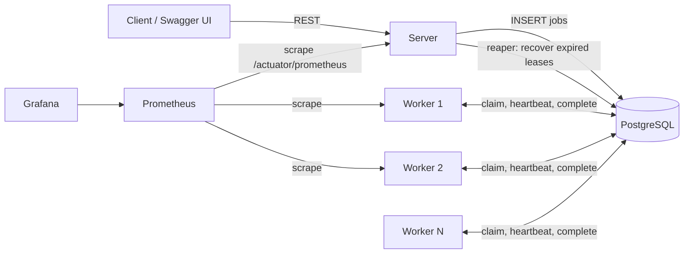
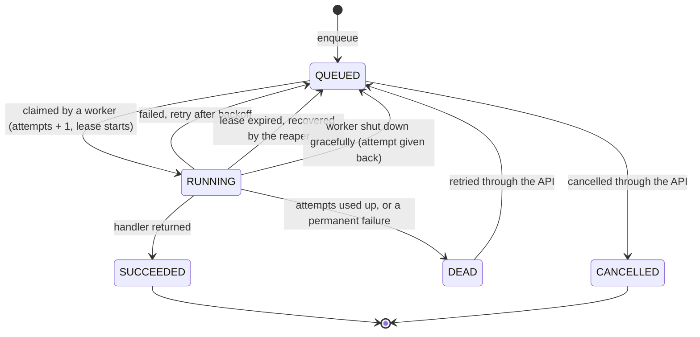

# Distributed Job Queue

An asynchronous job queue in Java 21 and Spring Boot that uses **PostgreSQL as its only broker**. Workers on any
number of machines take jobs with `FOR UPDATE SKIP LOCKED`; delivery is at-least-once, dead workers are detected by
leases and their jobs recovered, and stale workers are kept from overwriting results with fencing tokens. These
guarantees are checked by automated tests and by killing and freezing real worker containers.

## Features

- **Enqueue:** REST API, idempotent enqueue (a repeated request returns the existing job), batches of up to 1,000
  jobs, delayed jobs (`delaySeconds` / `runAt`, measured on the database clock) and priorities.
- **Workers:** handlers are plain methods marked `@JobHandler("type")`, run on virtual threads, with a time limit per
  job, retries with exponential backoff and jitter, and a dead-letter state (`DEAD`) after the last attempt.
- **Queues:** several queues, each with its own concurrency, so a slow queue cannot starve a fast one.
- **Reliability:** leases with heartbeats, a reaper that recovers jobs of dead workers, fencing on every write,
  graceful shutdown that gives unfinished jobs back without using an attempt.
- **Operations:** admin API (list, inspect with attempt history, cancel, retry, queue overview) documented with
  OpenAPI and Swagger UI; Prometheus metrics and a Grafana dashboard.

## Quickstart

Requires Docker (and a bash-like shell; on Windows, Git Bash).

```bash
docker compose up --build --scale worker=3 -d       # Postgres, server, 3 workers, Prometheus, Grafana

# enqueue a job and read it back
id=$(curl -s -X POST localhost:8080/jobs -H "Content-Type: application/json" \
  -d '{"queue":"default","type":"echo","payload":{"hello":"world"}}' | sed -E 's/.*"id":"([^"]+)".*/\1/')
curl -s localhost:8080/jobs/$id        # status is SUCCEEDED within a few seconds
```

| What | Where |
|------|-------|
| Swagger UI (try every endpoint) | http://localhost:8080/swagger-ui.html |
| Grafana dashboard (no login to view) | http://localhost:3000 |
| Prometheus | http://localhost:9090 |

More to try:

```bash
scripts/demo.sh 40                     # 40 jobs, shows which worker ran how many
scripts/load-wave.sh                   # waves of jobs: watch the queue fill and drain in Grafana
scripts/chaos/chaos-test.sh            # kill and freeze real workers while 10,000 jobs run, then check invariants
./mvnw verify                          # build and run all tests (needs Docker for Testcontainers)
docker compose up -d postgres          # only the database, if you run the apps from your IDE
```

PowerShell versions of the scripts are next to the bash ones (`demo.ps1`, `load-wave.ps1`, `chaos-test.ps1`).

## Architecture



There is no leader and no component talks to another directly: the database is the only meeting point. Workers
never hold a connection or a transaction while a handler runs; claiming, heartbeating and completing are separate
short statements.

## Life of a job



The core of the design is two statements. A claim picks and marks jobs in one step, skipping rows other workers have
locked:

```sql
UPDATE jobs SET status = 'RUNNING', locked_by = :worker, locked_until = now() + :lease,
                attempts = attempts + 1, started_at = now()
WHERE id IN (SELECT id FROM jobs
             WHERE status = 'QUEUED' AND queue = :queue AND run_at <= now()
             ORDER BY priority DESC, run_at LIMIT :free_slots
             FOR UPDATE SKIP LOCKED)
RETURNING ...;
```

Every later write by the worker carries the fencing check, so a worker that lost the job changes nothing:

```sql
... WHERE id = :id AND locked_by = :worker AND attempts = :attempt AND status = 'RUNNING'
```

## Guarantees and the tests that prove them

| Guarantee | Proven by |
|-----------|-----------|
| A job is claimed by one worker at a time: 8 threads, 2,000 jobs, each claimed exactly once | [`JobClaimRepositoryIntegrationTest`](jobqueue-worker/src/test/java/dev/jobqueue/worker/claim/JobClaimRepositoryIntegrationTest.java) |
| 4 competing workers run 5,000 jobs with every job succeeding exactly once | [`CoreEndToEndIntegrationTest`](jobqueue-worker/src/test/java/dev/jobqueue/worker/CoreEndToEndIntegrationTest.java) |
| Enqueue is idempotent, even with 100 parallel identical requests | [`JobIdempotencyIntegrationTest`](jobqueue-server/src/test/java/dev/jobqueue/server/job/JobIdempotencyIntegrationTest.java) |
| A worker that lost its job cannot complete or fail it (fencing) | [`JobCompletionRepositoryIntegrationTest`](jobqueue-worker/src/test/java/dev/jobqueue/worker/completion/JobCompletionRepositoryIntegrationTest.java), [`JobFailureRepositoryIntegrationTest`](jobqueue-worker/src/test/java/dev/jobqueue/worker/completion/JobFailureRepositoryIntegrationTest.java) |
| A frozen "zombie" worker that wakes up after its job was reassigned is rejected | [`ReliabilityScenariosIntegrationTest`](jobqueue-server/src/test/java/dev/jobqueue/server/reliability/ReliabilityScenariosIntegrationTest.java) |
| Long jobs keep their lease through heartbeats; a stolen lease interrupts the handler | [`JobHeartbeatIntegrationTest`](jobqueue-worker/src/test/java/dev/jobqueue/worker/heartbeat/JobHeartbeatIntegrationTest.java) |
| Jobs of a dead worker are recovered; two reapers at once never recover a job twice | [`ReaperIntegrationTest`](jobqueue-server/src/test/java/dev/jobqueue/server/reaper/ReaperIntegrationTest.java) |
| With workers dying at random, no job is lost and each succeeds exactly once | [`RandomCrashesIntegrationTest`](jobqueue-server/src/test/java/dev/jobqueue/server/reliability/RandomCrashesIntegrationTest.java) |
| The same, with real processes killed and frozen with `docker kill` / `docker pause` | [`scripts/chaos/chaos-test.sh`](scripts/chaos/chaos-test.sh) |
| Retries back off exponentially with jitter, up to a cap | [`BackoffCalculatorTest`](jobqueue-common/src/test/java/dev/jobqueue/common/BackoffCalculatorTest.java), [`JobRetryIntegrationTest`](jobqueue-worker/src/test/java/dev/jobqueue/worker/poller/JobRetryIntegrationTest.java) |
| A job that keeps failing, or keeps killing its worker, ends up `DEAD` | [`ReliabilityScenariosIntegrationTest`](jobqueue-server/src/test/java/dev/jobqueue/server/reliability/ReliabilityScenariosIntegrationTest.java) |
| A hung handler is interrupted at its time limit and its slot is freed | [`JobTimeoutIntegrationTest`](jobqueue-worker/src/test/java/dev/jobqueue/worker/poller/JobTimeoutIntegrationTest.java) |
| A slow queue cannot starve a fast one | [`QueueIsolationIntegrationTest`](jobqueue-worker/src/test/java/dev/jobqueue/worker/poller/QueueIsolationIntegrationTest.java) |
| Delayed jobs wait for their time; higher priority goes first | [`JobSchedulingIntegrationTest`](jobqueue-server/src/test/java/dev/jobqueue/server/job/JobSchedulingIntegrationTest.java) |
| Graceful shutdown drains running jobs, then gives the rest back without using an attempt | [`GracefulShutdownIntegrationTest`](jobqueue-worker/src/test/java/dev/jobqueue/worker/poller/GracefulShutdownIntegrationTest.java) |
| Cancel and retry are atomic state transitions (a cancel never races with a claim) | [`AdminApiIntegrationTest`](jobqueue-server/src/test/java/dev/jobqueue/server/job/AdminApiIntegrationTest.java) |

The integration tests run against a real PostgreSQL started by Testcontainers; there is no in-memory database
stand-in.

**What is deliberately not guaranteed:** exactly-once execution. A job interrupted by a crash runs again, so handlers
must be idempotent ([ADR 002](docs/adr/002-at-least-once-delivery.md)).

## Design decisions

Short records of the main choices and what they cost:
[001 PostgreSQL as the only broker](docs/adr/001-postgresql-as-the-only-broker.md) ·
[002 At-least-once delivery](docs/adr/002-at-least-once-delivery.md) ·
[003 Leases, heartbeats and fencing](docs/adr/003-lease-heartbeat-and-fencing.md) ·
[004 No leader, `SKIP LOCKED`](docs/adr/004-no-leader-skip-locked.md) ·
[005 `JdbcClient`, not JPA](docs/adr/005-jdbcclient-not-jpa.md)

## Benchmark

Measured with [`scripts/benchmark/run.sh`](scripts/benchmark/run.sh) on one laptop (Intel Core i7-1255U, 12 logical
cores, 15.7 GB RAM, Windows 11 with Docker Desktop), PostgreSQL 17 with default settings, a `noop` handler, and the
database, the workers and the load generator all on the same machine. 20,000 jobs per repetition, 3 repetitions after a
warm-up; latency measured at a steady 100 jobs/s.

| Workers | Throughput, 3 repetitions (jobs/s) | Median | Latency p50 / p95 / p99 (s), median |
|--------:|------------------------------------|-------:|------------------------------------:|
| 1 | 767.1 / 397.5 / 799.4 | 767.1 | 1.485 / 3.734 / 4.000 |
| 3 | 1686.4 / 1234.5 / 1667.4 | 1667.4 | 0.738 / 1.871 / 1.952 |

Read these as relative behavior on modest hardware, not as capacity: repetitions vary, and the latency is most likely
the polling interval rather than the work (consistent with the design, not verified by a separate experiment; see the
limitations below). Method, environment, every repetition and the exact
reproduction steps are in [`docs/benchmark/results.md`](docs/benchmark/results.md).

## Limitations and future work

Honest list of what this project does **not** do:

- **At-least-once, not exactly-once.** Handlers must be idempotent. Fencing keeps a stale worker from writing to the
  queue, but cannot undo what its handler already did elsewhere.
- **PostgreSQL is the ceiling and a single point of failure.** Throughput is limited by one database, and this
  repository ships no high-availability setup for it.
- **Polling, not push.** Workers poll (500 ms, backing off to 5 s when idle), so a job waits about half a polling
  interval before it starts, which most likely explains the latency numbers above. `LISTEN/NOTIFY` would shorten it
  and was not built.
- **No retention.** Finished jobs stay in the table until deleted by hand. The claim path stays fast because its
  indexes only hold `QUEUED` rows, but disk use grows.
- **No security layer.** The REST API, the admin endpoints and `/actuator/prometheus` are open. Do not expose them
  publicly; an API key would be the first addition.
- **No recurring (cron) jobs** and no structured, per-job log context.
- **Cancelling works only for `QUEUED` jobs.** A running handler cannot be stopped from outside, and a timeout only
  interrupts handlers that respond to interruption (Java cannot kill a thread).
- **Benchmarks come from one laptop** with an untuned PostgreSQL; they show relative behavior and a starting point,
  not production capacity. Optimizations such as larger claim batches or tuned polling were not explored.
- **Out of scope by design:** job workflows (DAGs), multi-tenancy, a web UI beyond Swagger and Grafana, multi-region.

## How it compares

This project is smaller than the established tools and does not aim to replace them; it makes a few guarantees
explicit and tests them.

| | Idea | Difference from this project |
|---|------|------------------------------|
| **JobRunr** | Java background-job library storing jobs in a database, with a dashboard and recurring jobs | More complete and mature; this project is a smaller engine focused on the claim/lease/fencing mechanics and proving them under failure |
| **Quartz** | Java scheduler built around triggers and cron, with a JDBC store and database-lock clustering | Centered on scheduling rather than queue workloads; this project has no cron and centers on workers, retries and recovery |
| **Celery** | Python task queue on top of a broker such as RabbitMQ or Redis | Push-based with a dedicated broker and a large ecosystem; this project has no extra broker and trades latency for operational simplicity |

## Project layout

| Module | Contents |
|--------|----------|
| `jobqueue-common` | Shared types: `@JobHandler`, `JobContext`, statuses, backoff calculator, Flyway migrations |
| `jobqueue-server` | REST API, admin API and OpenAPI, reaper, queue metrics |
| `jobqueue-worker` | Worker engine: handler registry, poller, heartbeat, completion, graceful shutdown, demo handlers |

Also: `docker-compose.yml` (whole stack), `docker/` (Prometheus and Grafana configuration), `scripts/` (demo, load,
chaos and benchmark scripts), `docs/adr/` (design decisions), `docs/benchmark/` (benchmark results).

Built with Java 21, Spring Boot 4, PostgreSQL 17, Flyway, Testcontainers, Micrometer, Prometheus and Grafana.
